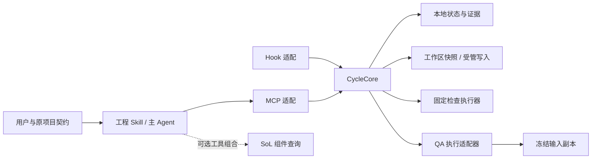

# Agent Engineering Cycle：独立插件架构 v2

状态：2026-10-07 架构基线 v2。独立插件已进入实施，当前能力与验收状态见 [IMPLEMENTATION_STATE.md](../IMPLEMENTATION_STATE.md)。本页保留架构阶段的决定与计划，不以设计声明替代运行证据。用户已明确选择「独立插件，参考 codex-sol」；这份方案不要求修改/安装 SoL。目标是把现有 agent-engineering-cycle Skill 的机械约束落实为运行时合同，保留 Agent 的工程判断与用户的关键决定。

配套：[实施与验收计划](acceptance.md)、[评审与裁决记录](review-history.md)。原始草案/四角色报告/定向复核保存在 [2026-10-07 记录目录](reviews/2026-10-07/)。

默认能力增量见[DEFAULT-v1](default-configuration.md)：内置配置、宿主项目定位、免登记发现和首次任务。2026-10-10方案已评审、尚未实现；其新合同不改变本页历史基线或现有运行证据。

## 1. 本轮决定与交付边界

**ADR-01**：独立插件自带一个小型、无传输依赖的 CycleCore；MCP、Hook 共用其状态和检查。SoL 是职责分工、版本/证据、租约、恢复的参考，不是当前代码依赖。

**ADR-02**：首版不复制 SoL ChangeCoordinator，不深层 import 私有源码，不依赖未发布公共库。SoL 的 module_uid/architecture query 输入是其组件业务合同。可选组件分析由 Skill 使用宿主实际提供的 sol_architecture_query；无 SoL 或无 JS 登记时基础循环仍可用。跨 MCP 自动调用不是已有能力。

**ADR-03**：职责/接口/状态合同先冻结；真实 QA、授权来源、Hook覆盖、跨进程锁与取消经过 P0 才启用相应 verified 能力。源代码/CLI help/官方文档只给入口，不等于宿主验收。

架构阶段交付架构、接口/状态/失败合同、实施分期和验收矩阵。当时未交付新 MCP、Hook 或 QA driver；用户后续“做吧”已授权本地实施，当前结果沿实施状态维护。已安装旧 Skill、SoL与用户全局配置仍不在修改范围。

## 2. 目标和范围

沿用户当前授权推进：原需求 R → 设计 D → 实施与实际状态 I → 独立 QA Q → 修缺陷或需求增量 Delta → 本轮收尾/下一授权目标。Agent 负责调查、常规决策、实施、自检、文档、QA协调和修复；只有产品/兼容/数据/权限等未决关键选择交给用户。

首版：本地单工作区、一个活动可写 cycle；支持已有 docs/design、.prd/、蓝图/NEXT 和自由格式实现记录的引用接入。核心不要求 JS 组件树，也不创建第二 PRD。阶段依任务缩放，明确小修复不自动铺全流程。

程序核验结构、来源、版本、操作权限、执行与发布事实；QA 和主 Agent 判断需求理解、设计、测试有效性和用户场景。程序不能认证自然语言判断正确，也不能观测隐藏服务端 Prompt。

## 3. 模块与实际消费者

| 模块 | 唯一职责 / 调用方 | 接口与副作用 |
| --- | --- | --- |
| CycleCore | MCP/Hook使用的业务状态、版本校验、完成条件与安全下一动作 | 无MCP/Host依赖；通过本地适配器读写cycle/证据；不调用模型、生成Prompt或解析任意Shell |
| LocalStore | 当前指针、不可变记录、请求去重、同工作区跨进程租约 | 同文件系统原子创建/发布；负责CAS、pending/outcome/settle；普通文件系统以外的平台不默认支持 |
| WorkspaceAdapter | 有界输入清单、冻结字节、精确目标写入与变化事实 | 路径/链接/控制目录保护；保存前后身份与实际变化；不维护第二个cycle |
| CheckRunner | 项目配置的固定argv、cwd、运行条件与真实回执 | 超时/取消/进程树/输出完整度；不接收模型生成的执行命令 |
| QAAdapter | 受控新执行或宿主观测，以及输入交付/身份/终态事实 | 异步job、冻结副本、能力等级、原始报告引用；禁止用报告中的布尔值铸造身份 |
| Authority/DecisionAdapter | 原权威文件映射、批准事件/操作许可的来源 | 原文档继续归原owner；记录可见来源与可信等级，不自行判定自然语言授权 |
| MCP/Hook适配 | 校验外部输入/宿主取消/事件，调用同一核心 | MCP不复制业务规则；Hook不直接改业务JSON、不依赖MCP已连接才能读本地状态 |
| Skill | 唯一语义协调与原文档写回责任 | 原目标/非目标、设计、I说明、QA裁决、Delta；使用当前runtime返回的缺项，不自行宣布程序完成 |

预计目录按这些职责安排：src/runtime.mjs 组装；src/core/ 放领域合同/协调；src/local/ 放状态、工作区与执行；src/adapters/ 放 MCP/Hook/QA/来源；skills/agent-engineering-cycle/ 是后续随插件分发的Skill来源。目录是实施建议，不是已创建模块，不先建空框架。

同一公共合同由 core/contracts 唯一维护，MCP schema、Hook投影和测试消费它；Skill仅解释，不重复定义状态枚举。无需公共provider注册框架、事件总线或通用工件DSL。

## 4. 单一事实来源与接入

| 内容 | 权威owner | 核心保留 |
| --- | --- | --- |
| R/D、已有决定、Delta正文 | 原项目PRD/设计/蓝图owner | 路径/锚点/原ID、修订与不可变证据引用 |
| I工程说明与下一步 | 原项目I/NEXT，由主Agent维护 | 已提交说明的引用、输入身份、缺项/同步事实 |
| 检查命令/QA策略 | 项目配置与插件内置具名策略 | 生效配置摘要、策略ID+revision、必要检查集 |
| 执行/归档/清理事实 | 对应runner/store/host适配器 | 不可变原始回执，禁止模型覆盖 |
| QA语义发现 | QA执行者报告、主Agent裁决 | reported报告引用；执行独立性、当前性另由核心核对 |
| 活动cycle/版本/pending/完成 | CycleCore | 唯一运行指针与历史链 |

首次adopt只登记已确认的权威来源/锚点和内容身份；旧ID不重编，无ID可局部回链。未映射字段标 unknown，不从文档“已通过”推导验证，不自动迁移或改写原件。R/D/I取证副本不可编辑，也不是第二个可决定范围的正文。

运行数据建议位于项目 .codex/engineering-cycle/，使用独立namespace，不写 .codex/sol/。其中状态/证据/控制配置不允许经受管产品写入修改；它们不是项目验收输入，避免自身更新造成无穷失效。严格“任何文件都不写”的任务只使用非持久 inspect，不自动begin或归档。

## 5. 数据与正交状态

`CycleBinding = { workspace_id, cycle_id, revision, basis_digest }`。revision标识持久指针；basis_digest标识本次相关来源/权限/策略/输入。每个mutation传期望binding；核心在租约内重读和核对，不凭工作区或旧聊天继承任务。

- **stage**：requirements / design / implementation / qa / reconciliation / ready。是当前工程位置，可复用已有效环节，不强制每轮重做。
- **lifecycle**：active / interrupted / completed / abandoned。
- **blockers[]**：带原因、证据和恢复条件的阻塞；blocked为派生视图，不覆盖stage。
- **pending_operation**：操作ID、请求摘要、输入binding、启动/效果已知性与结算位置。
- **artifact_refs / sync_status**：到权威/报告/回执的引用及待写回项；正文不复制成可编辑主副本。

`completed`是核心检查并发布的历史里程碑；status再次核对当前证据，外部漂移时返回 current_complete=false / stale，不把历史Q删除，也不自动执行修复。恢复/重新启用仍需当前动作许可。

`EvidenceRef`包含类型、schema/contract revision、不可变内容摘要、范围/完整度与可召回ID。来源类型区分 observed / reported / imported；模型record只能提交语义说明/来源，不能直接设 observed、QA_verified、approved或completed。

## 6. 首版操作合同（拟定工具，不是已有API）

采用七个有界工具；动作是各自职责内的discriminated union，不开放任意状态转换。

| 工具 | 公共输入 / 输出 | 副作用与失败 |
| --- | --- | --- |
| cycle_control | begin、resume、abandon、finish；来源/当前许可、scope、期望binding、request_id → binding/生命周期/缺项 | begin登记原来源；resume不重放；finish不接受completed布尔值；错版本/缺许可拒绝 |
| cycle_status | 当前工作区/显式cycle → 只读当前投影、证据有效性、pending与下一安全动作 | 不启动runner、不修源文件；未绑定返回unbound；strict inspect不创建store |
| cycle_artifact | prepare/attach，种类R/D/I/Delta、来源refs、prepared_handle与期望binding → 有界输入/被接收引用/缺项 | 只接入取证/语义说明；未知源/错误类型/陈旧prepared拒绝；结构接收不等于验收通过 |
| cycle_apply | request_id、期望binding、write/delete精确目标、前态摘要与内容 → 实际变化/已知性/回执 | 同租约校验再写；首版全文件受管更新，不自写patch引擎；patch支持待实际需要和平台适配验证 |
| cycle_verify | 配置的check_ids、binding、输入manifest、request_id → 运行/归档/清理事实与回执 | 只运行固定argv；未配置不回退假成功；输出失败/取消可有已发生效果 |
| cycle_qa | start、status、cancel；冻结R/D/源码manifest、策略、绑定 → job与assurance/report refs | start由程序创建执行；status不重新启动；晚到/错绑/能力不足不生成有效Q |
| cycle_reconcile | Delta提议、可核对决定ref、权威写回计划/回执、binding → proposed/approved/同步状态 | 批准与动作许可分开；不能用模型来源字段自批；写回走cycle_apply并核对前/后态 |

公共响应统一含 binding、stage/lifecycle、operation/job、blockers、evidence_refs、允许的下一动作与未证实范围。错误保留 source/ref 和可操作原因，不泄露秘密。大输出有预算与精确分页引用；不把整份历史注入每轮。

首版错误类：BINDING_STALE、SCOPE_DENIED、DECISION_UNVERIFIED、SOURCE_UNAVAILABLE、SNAPSHOT_INCOMPLETE、QA_VERIFICATION_UNAVAILABLE、POLICY_STALE、OPERATION_PENDING、OUTCOME_UNKNOWN、AUTHORITY_CONFLICT、EVIDENCE_INVALID、DRIVER_UNAVAILABLE、CAPABILITY_UNAVAILABLE、LEASE_BUSY、REQUEST_CONFLICT、STORE_UNAVAILABLE、OPERATION_FAILED、OPERATION_PARTIAL。请求摘要不匹配返回REQUEST_CONFLICT；执行/捕获/清理的具体失败保留failure_phase与原始错误ref，不靠增加每种进程错误的公开码。输入schema仍需P1冻结；此表已确定各操作责任/副作用，不构造第三方SDK函数名。

### 6.1 错误、持久化与重试的逐操作合同

共同前置条件是当前scope/许可、所需能力和期望binding；租约忙返回LEASE_BUSY，旧binding/缺权限/改参ID在副作用前拒绝。状态查询不用幂等键；所有持久mutation使用request_id。相同ID+相同请求先查已有operation，返回原结果和当前有效性，不重新运行原动作；新尝试需新许可下明确处理旧pending，不能用换ID绕过。

每个effect-bearing操作在效果前保存pending；效果后保存不可变outcome，再settle。响应包含稳定operation/job、failure_phase、effects_known及原始ref。`OPERATION_FAILED`不表示没有效果，`OPERATION_PARTIAL`表示已知部分效果；无法查证时OUTCOME_UNKNOWN优先，不能填changed_paths为空冒充无变化。

| 工具 / 动作 | 持久化点与失败状态 | 同请求 / status恢复 |
| --- | --- | --- |
| cycle_control begin/resume/abandon | 来源/Grant与活动指针预检后登记pending，再原子发布指针；STORE_UNAVAILABLE保留pending/可回查指针。resume只恢复状态不执行旧runner；abandon遇活跃/未知效果返回OPERATION_PENDING，先明确取消/结算 | 原request返回同cycle/operation；观察指针+outcome可结算，无证据保留unknown。completed/abandoned为历史，重新做获准目标用新cycle引用前轮，不把旧历史改成active |
| cycle_control finish | 门禁不全返回对应缺项错误；完整归档后重核basis再发布。归档/发布错误为STORE_UNAVAILABLE，未发布保持unfinished；发布事实不明则OUTCOME_UNKNOWN。发布后漂移显示current_complete=false | 只查归档/发布事实，绝不重跑检查/QA；只有验证过的完成证据与指针可settle，否则保留阻塞 |
| cycle_artifact prepare/attach | 默认prepare只读有界来源视图；若持久取证也需request_id及许可。attach保存ref后才推进；SOURCE_UNAVAILABLE/EVIDENCE_INVALID/BINDING_STALE不接为当前工件。存储失败不把已存不完整ref升为accepted | 重试查询同ref/operation；可回查完整来源与归档才settle。严格inspect不创建持久handle或store |
| cycle_apply | 执行前预检全部精确目标和前态，保存pending；逐目标原子write/delete并记outcome，不承诺跨文件事务。后续目标失败且效果可核对则OPERATION_PARTIAL+unfinished；捕获不到真实效果则OUTCOME_UNKNOWN | 返回同operation与每目标事实，不重写。前/后/第三态只帮助核对；显式续写走当前许可的新请求，冲突不覆盖 |
| cycle_verify | 固定配置/输入身份/Grant预检；pending在launch前保存。可核验启动失败为OPERATION_FAILED+not_started；已启动失败/捕获/清理错误保留started、终态/效果的独立事实。终态/效果缺证时OUTCOME_UNKNOWN，输出不全不产生pass | 同request回原runner及回执；status只取证/结算，不再launch。取消请求不等于进程已停；未证实终态/残留阻塞finish |
| cycle_qa start/status/cancel | start先验证快照/driver/Grant、登记job/pending再launch。DRIVER_UNAVAILABLE/QA_VERIFICATION_UNAVAILABLE不接受Q。cancel独立request只取消原job，返回cancel_requested直至观测终态；缺终态为unknown。晚到/错basis只存历史report，current Q保持未接受 | start重试返回同job；status不launch。cancel重试查原取消结果，不新建QA；仅终态/输入/策略已证明且仍当前的报告可接为Q |
| cycle_reconcile | proposed/decision/sync-plan各动作有binding/request；批准前DECISION_UNVERIFIED无升级。计划先存精确前/后态与apply操作ref，写回由cycle_apply执行；第三态AUTHORITY_CONFLICT，部分写回OPERATION_PARTIAL，缺效果证据OUTCOME_UNKNOWN | 查原计划/每文件outcome。后态核对后结算；前态需显式获准续写；第三态保留冲突。全部权威目标身份核对后才incorporated，仍不等于代码实现 |

公开语义由CycleCore的一份转换合同产生，MCP/Hook不自行猜测错误是否可重试。P1故障注入按此表核对同operation、局部效果和安全下一动作；完整字段schema由同一owner维护。

## 7. 权限与批准来源

ActionGrant与RequirementDecision分别记录。Grant限制本轮mode（inspect/docs/implement）、操作与路径；R2获准不扩大Grant。候选Delta可由模型创建，批准证据只能由配置的受信DecisionAdapter录入。

DecisionEvidence至少关联原始可见事件来源、宿主/session或operator通道、cycle、精确Delta/版本或动作范围、来源摘要与观察等级。`source=user`、合法UUID、导入文本或角色字段不是认证。引用/历史/自动续跑提示也不能自动成为新用户批准。

源事件可见性与授权语义分开：adapter证明看到了哪个事件/确认结果，Skill/主Agent判断它是否覆盖本请求。关键扩范围若缺明确受信来源，保持proposed/DECISION_UNVERIFIED，不默认为同意。已有且仍适用的许可/决定可复用，不为每步重复找用户。

P0必须验证目标宿主的用户决定/结构化确认来源、自动续跑与真人输入的区分。若只能取得普通文本或model表单，就保留reported/unknown；不宣称已实现机械批准。受信通道、控制配置和后台证据是插件的信任基础，无法抵御拥有同一OS权限的任意外部进程；这是工程门禁，不是完整安全隔离系统。

### 7.1 能力到操作的门禁

| 未通过 / 缺证能力 | 仍可用 | 核心必须拒绝或限制 |
| --- | --- | --- |
| 本地Store/跨进程lease能力 | 非持久strict inspect、有界只读来源视图 | 所有持久mutation/runner返回CAPABILITY_UNAVAILABLE；不以进程内状态代替生产Store |
| DecisionAdapter或当前ActionGrant无可信来源 | inspect/status、reported来源的非持久视图 | 持久begin/resume/abandon/attach、docs/implement写删、verify/QA启动、Delta批准/原主控写回/finish均拒绝DECISION_UNVERIFIED；不能靠Skill已运行或model说“获准”绕过 |
| 必需QA driver/保证维度 | 已有可信Grant下的文档/实施/固定非独立检查 | 对要求独立QA的cycle返回QA_VERIFICATION_UNAVAILABLE，停在ready_for_external_qa，finish不能发布完成 |
| Hook事件/turn/拒绝覆盖 | 已验MCP受管入口与能力说明；Hook可只提醒 | 不发未证实的block/ticket，不宣称拦截未覆盖工具；外部变化使旧证据失效 |
| 原操作终态/效果/清理未知 | status、取证，以及复用该job仍适用许可的显式取消/结算 | 不重启、重写或finish；取消未观测终态继续unknown，不能删除仍可能活跃的锁 |

同一能力表由core消费并投影到MCP/Hook，不重复维护profile权限规则。只有所需能力和当前Grant都满足才启用动作；可信来源失败时可继续开发静态合同/测试，但产品保持inspect/未就绪。有效且仍适用的原许可继续复用，不为每步新问用户。

## 8. 冻结QA输入、身份与当前性

QA只接受程序生成的输入manifest：冻结的原R/验收、相关D/不变量、源码/测试/必要配置、原始检查事实。不传实现者推理/成功判词或上次Q verdict。I仅必要构建事实可核对使用，不能整体带判词注入。

**冻结是实际副本**：从相关实际字节捕获到内容可回查的snapshot，核对捕获完整度与来源身份，发布后不可改；QA读取/验证该副本，不读共享活动工作树。包括相关dirty/untracked输入，排除运行控制目录及声明的生成物。只做起止hash采样不能防ABA，不能替代副本。

快照不足、相关链接/路径无法安全表示、必要秘密/外部依赖不能按授权隔离、预算超限时明确SNAPSHOT_INCOMPLETE/受限，不用假配置补齐。声明输入覆盖范围，不能宣称没有枚举的动态依赖已被覆盖。QA需要输出/缓存时放独立可写输出区，受验输入仍不可变；Readonly权限与副作用须在目标平台PoC实证。

Q至少绑定：R/验收修订、snapshot、相关源码/测试/配置、固定检查身份、QA policy ID+revision、关键工具/环境、driver版本及执行/报告引用。改变QA策略也使受影响旧Q失效。仅能证明同输入/同规则/同关键环境的检查可复用，不每轮哈希全仓或重复全套构建。

QAAdapter独占生成执行事实：job/request ID、实际process或Host actor、父任务关联、客户端送入的精确输入manifest、配置/指令可见覆盖、权限证据、运行/终态、输出完整度。QA报告只提交语义发现，不提交可升级为可信身份的标志。

保证维度分别记录 distinct_execution、fresh_session、frozen_input_delivery、permission_observed、terminal_observed；隐藏服务端上下文、模型真实身份或“判断一定正确”不在保证内。缺所需维度不得称独立QA通过。非独立本地检查仍可留存，但不能静默替代本轮要求的独立QA。

两条候选驱动均需P0：

- **受控CLI exec**：wrapper掌握启动参数/精确输入/副本/进程与JSONL；无resume。当前help有read-only、never、ephemeral、json入口，但ephemeral仅不落rollout，不能证明全部配置/上下文隔离；auth/用量仍存在。验证版本、沙箱、ambient配置/AGENTS/插件、终态和进程树后才启用。
- **native subagent观测**：Host给独立agent ID及生命周期；SubagentStart不含完整prompt，Stop/transcript也不能单独证明成功/取消。需要可用受支持trace将初始输入、child和终态关联；UUID格式与parent字段不能代替证据。

P0先检验CLI这条程序可控入口，同时将native路径作能力对照。逐候选记录not_attempted / blocked_by_authorization / unavailable / failed / passed；只对实际可用且已获授权的候选做live调用。首版只要求至少一个驱动满足全部required assurance，默认可从实际passed候选中选择；另一条未实测就保持unknown，不能宣称比较胜出，也不为凑矩阵强制额外调用。无通过驱动时停在ready_for_external_qa/未就绪，不自动换模型/改宿主配置或宣布完成。

## 9. 租约、幂等、取消与恢复

Hook/MCP多进程进入同一LocalStore租约。创建活动cycle、重读binding/CAS、登记请求/pending和指针发布是同一临界区；不只用进程内mutex。首版只在P0已验本地文件系统运行，不默认网络盘/云同步目录。

有副作用的操作必须有稳定request_id+规范请求摘要。租约内持久化operation_id/pending后才启动；相同request重试查询已有操作，改参数重复ID拒绝。存在未知pending时禁止生成新ID隐式重跑相同工作。纯status不添加执行幂等状态。

保留正交事实：launch_status（not_started/started/unknown）、terminal/exit/signal、changed_paths及是否已知、capture_error、cleanup_error、output completeness、outcome_ref、settle状态。空exit_code不代表没执行。原始runner事实不得在公开回执投影中被剥掉。

执行后先保存可核验outcome，再关联归档/指针、结算。归档/结算失败保留真实效果；可查证outcome则恢复known，无法证实时OUTCOME_UNKNOWN/unfinished，不造ChangeEvent、不自动回滚/重放。人工新尝试仍需明确处置旧pending与当前许可。

普通本地写入/检查在其执行窗口内持有工作区执行租约；长QA job先保存冻结binding再释放租约。晚到结果要重核job/basis/策略/当前输入；当前源改变时可保存历史报告但不能接受为当前Q。

锁owner/执行进程树的存活与可恢复事实需平台验证；只因timeout不删除可能仍在用的锁。不能查明时LEASE/OUTCOME阻塞。标准MCP取消、Host Interrupt、driver退出各有能力边界；不靠Stop推断已取消。每个执行adapter有明确超时、子进程清理与恢复责任。

外部编辑器不遵守租约。受管路径只保证自己的串行/版本检查与实际效果记录，外部漂移另行检测；不宣称阻止/保全所有外部竞争写入。并行编辑相同范围应先停止或通过新的协调设计解决。

## 10. 原主控写回与完成

写回计划记录source owner、精确目标、前态摘要、预期后态摘要、批准/动作许可和operation ID。多文件逐项记录，不假装跨文件事务。恢复读取目标：已匹配后态就结算；仍是前态时只有经当前许可的显式安全续写；第三种状态AUTHORITY_CONFLICT，不覆盖外部变化。

Delta incorporated仅指原权威已写回且核对身份，源码/运行验收另记。已有自由格式I保持原格式与历史，核心只引用被提交版本，未写回留approved-but-unreconciled。

finish在同租约核对：当前授权目标/来源、必要R/D/I引用、有效且满足所需维度的Q、必要真实检查、原用户场景覆盖的语义裁决、无未解决关键发现、无活跃效果未知操作、原记录同步。先归档完整完成证据，再次核对basis/条件，再发布completed。归档/发布失败留unfinished。

本轮完成不授权下一新目标。只有已有授权且可执行的后续目标可开启下一cycle；候选/推荐停在原待办，不后台定时唤醒、不自动commit/push/部署。

## 11. Hook与Skill接入

- SessionStart/恢复：只给当前绑定、stage/阻塞、引用和下一安全动作，不重跑runner或重放写入。
- UserPromptSubmit：有界当前性提醒；来源采集与业务决定分开，不能只看“用户角色”标签就授予权限。
- PreToolUse：只覆盖明确匹配且实际验收的路径；原生写工具可拒绝并引导本插件MCP，受管MCP后端仍二次guard。未覆盖Shell/专业工具不冒称被拦截。
- Stop：当前turn最多一次；同cycle revision+action不重复发同一提示。核心只有无新授权、尚未执行、输入当前且可判定的动作才发continuation ticket；阻塞/等待/中断允许unfinished退出。ticket记录在核心独有辅助ledger，Hook不另造业务状态；缺有效turn/continuation证据只提示，不block。

未来插件内Skill是唯一维护来源，安装目录只是分发副本。当前独立Skill原样保留。实施时新增runtime模式：发现工具/能力后使用程序事实；不支持则明确“纯指令模式、未取得运行时保障”，不伪造Hook/MCP激活。不得同时注册两份同名维护源或静默升级用户安装。

## 12. 分期与实施门

**P0 可行性与能力门**：真实独立安装发现/启动；本地跨进程lease/CAS和崩溃恢复；DecisionAdapter来源/权限；CLI/native QA输入/身份/终态/readonly；Hook覆盖/失败/重复Stop；无SoL Python/docs-only。每个能力版本与证据一起登记。许可不足或PoC失败就保持未就绪，不能靠schema宣布go。

**P1 核心最小闭环**：按上述七操作实现来源接入、binding、受管write/verify、不可变回执、status/显式恢复。已有原文档不迁移；check有效失败、busy/conflict、known/unknown与同request去重有自动测试。只启用P0通过的能力。

**P2 QA/同步/收尾**：已验driver的真实fresh QA与归档、原标准缺陷/新Delta分流、权威写回恢复、finish与Stop ticket、Skill runtime接入。跑一轮及下一已授权增量，来源/范围/失败/清理检查齐备后才叫闭环。

**P3 交付验收**：完整本地插件装配/信任/重启/取消与受支持平台矩阵；旧纯Skill路径兼容、无SoL路径、输入/输出预算。真实长期模型效果、token/费用/耗时另做授权实验，不在首版凭静态检查宣称收益。

各批次owner按实际职责划分：core合同/状态唯一owner，LocalStore与执行、Host/QA、MCP/Hook、Skill分别消费它；跨接口改动同步真实调用方。测试和docs随同一owner变化，不按文件数拆任务。验收细节见 [acceptance.md](acceptance.md)。

## 13. Out-of-Scope

架构阶段未实现/安装/运行真实QA PoC；后续本地实施及隔离PoC沿当前用户授权与实施记录推进。仍不修改codex-sol，不发布共享核心库，不自动commit/push或改用户全局配置。首版不做通用DSL、自动PRD迁移、全语言索引、任意Shell执行器、多可写cycle、完整安全隔离、无限后台循环或性能收益承诺。结构/版本/执行证据不能替代QA语义判断。

## 14. 2026-10-08 组件复用与上下文控制增量

用户在博客评分后确认“写代码前查现有组件”、复用 SoL 发现能力、单一写入控制及 Hook 注入控制，并要求四角色架构审核后写文档。新增合同为 [CRCTX-v1](component-reuse-context.md)，[实施文档](component-reuse-implementation.md)分列实际代码与拟改路径；[REUSE-01–12](acceptance.md#组件复用与上下文控制增量)不替代原 AC-01–18。

本增量选择独立 SoL provider-only，经 Cycle 内部 gateway 按需发现/读取；产品仍独立，旧无 provider 项目保留原语义。D 唯一决定区块与实际捕获身份驱动写前门禁；source 目标覆盖不由 implementation_targets 决定；受管消费者 cursor 与共享实现/登记漂移分开。Hook 使用 session 路由、完整 JSON 2048 UTF-8 字节预算及有限去重，Stop 保持无续跑。

四角色原始报告、主 Agent 裁决和定向复核见[评审历史](review-history.md#2026-10-08-组件复用与上下文控制)。本增量目前只有设计文档，provider、rev2/门禁、Hook 新策略与 v2 评分未实现；不会把旧 TUI/141项或静态审查当新运行时证明。本节定义后续架构演进，不授权本轮修改 SoL、代码、全局安装或旧报告。
