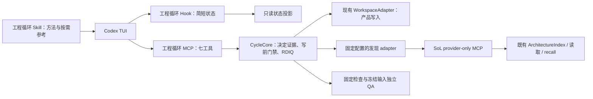

# 组件复用与 Hook 上下文控制设计

修订：CRCTX-v1，2026-10-08；实施更新：2026-10-09。状态：四角色评审合同已进入实际实现，用户后续明确“ok 改吧”授权修改。源码门禁、provider-only、Hook 会话/预算、QA 证据分页和 v2 贡献评分已实现；具体检查与宿主边界见[实施文档](component-reuse-implementation.md)。原始意见及裁决见[评审记录](review-history.md#2026-10-08-组件复用与上下文控制)。本增量沿用原 R/D/I/Q、权限和恢复合同，不创建第二套规划系统。

2026-10-09 输出补充：工具仍为原七个，所有输入 schema 不变；discover/read 与 reuse 状态只增加有界结构化输出和 D 诊断。旧文本视图及证据分页保留审计兼容，正常选择不靠重复分页重建归档。

## 1. 目标和当前缺口

写产品代码前发现已有能力，查看真实接口、实现与受影响调用方；选择复用、兼容扩展或有证据的新实现。程序保证来源身份、覆盖和门禁，独立 QA 判断实际适配与结果贡献。不能以 import、一次调用或模型自述代替有效复用。

评审时的缺口是七工具没有写前复用门禁，Hook 没有 session/去重/字节预算，SoL 只有完整流程入口。本轮在原七工具内接入复用捕获与门禁，保持 `implementation_targets` 仅为说明目标，并新增独立发现入口。旧 rev1 项目仍沿原行为；采用本文能力须显式配置 rev2 策略。

博客 v1 保留：行为 41/41，合规 88/96，严格成功 2/8，严格有效复用 4/25，实际调用观测 19/25。六题登记文案变更影响严格评分，B04/B07另有复制函数体；不能解释成六题功能失败，也不能据此推断 Hook 的因果收益。来源为[原始验收记录](../evidence/benchmark-blog-20261008.md)。

## 2. 职责和部署边界

| 层 | 唯一责任 | 不授予的能力 |
| --- | --- | --- |
| CycleCore / LocalStore | 工程状态、D 证据、binding、受管写入、检查、QA、恢复 | 不能从模型字段生成批准或改验收 |
| SoL provider | 发现、源字节与静态关系、原始输出召回 | 不拥有工程决定、产品写入、完成或自动续跑 |
| Hook | 投影程序状态、已匹配原生写入口的短拒绝提示 | 不决定复用、不启动 provider、不执行检查 |
| Skill | 解释何时查询、怎样判断适配、怎样查看证据 | 不替代运行时门禁、不重复贴完整源码或设计 |

选择 **Cycle 内部 gateway 调用独立 SoL provider**，模型仍只见七个 cycle 工具。provider 的 query/read/recall 按需经 `cycle_artifact` 调用，避免让模型转述结果充当可信回执，也避免第二份流程 instructions。provider 独立分发；cycle 不私有跨仓 import，不复制 Acorn/Normify 索引。

支持组合为工程循环 + provider-only。同一任务启用完整 SoL 控制面属于冲突组合；操作者通过现有宿主清单核验，有实际观测能力才自动诊断。不得自动关闭全局插件或猜测所有 Hook 已关闭。唯一写入 owner 的承诺限定为本集成的**受管产品写入口**；Shell、外部编辑器及未观测插件仍是覆盖边界，相关输入变化会使证据过期，不能宣称全宿主独占或 OS 隔离。

## 3. provider 公共合同

以下为拟实现合同，当前 SoL 不接受这些配置或模式。

- 独立入口、独立打包 manifest；不调用 `createSolRuntime/createSolServer` 全量工厂，不初始化 ContextSessions/ChangeEngine，不注册 Hook，不带工作流 Skill 或 server 流程 instructions。复用 ArchitectureIndex、路径保护、ObservationPack/read/recall 原语。
- 内部 MCP 只允许 `sol_architecture_query`、`sol_read_file`、`sol_recall`。initialize 能力元数据提供独立协议 `sol-component-discovery/1`、工作区身份、声明文件身份、产品写入 none、观测缓存写入边界；gateway 同时检查实际 tools/list，不能仅凭 server 的 `0.1.0` 字符串接受。
- 操作者配置固定 executable、argv、发行 manifest 身份、协议版本、工作区内声明路径和超时。gateway 使用 shell=false、受控环境、固定 cwd，不接收模型命令、npx 下载或响应内的执行建议。完整分发身份含运行时代码和锁文件；只检查入口文件不足以防依赖漂移。provider 是受信本地组件，清单/声明不构成 OS 权限隔离。
- 观测归档可写到**显式专用 provider-cache**，只保存传输原字节与索引，不保存 D 选择、业务阶段或完成状态。需给现有 ObservationStore 增加受校验的存储位置选择；这是待实现能力。完整 SoL 的 `.codex/sol` 状态语义保留。Cycle 归档可独立恢复的证据后，cache 可清理；它不是第二个工程事实来源。
- query 除现有 selected view 外，返回完整输入 manifest：声明和所有被索引源码的安全相对路径、SHA-256/缺失事实、query 参数、version、diagnostics、uncovered。现有 `ArchitectureIndex.select()` 单独返回的 version 不足以让 cycle 重读核验；新入口需包裹 `load()` 的 versions，而不是编造摘要。
- 所有读取限定当前工作区和现有安全路径规则，拒绝秘密/控制目录、链接、越界和不支持的输入。声明中的源路径必须在索引读取前校验，不能等输出后才发现读了秘密。静态 JS ESM 是首版覆盖；动态调用、其他语言、登记缺失显示 uncovered，不把空候选解释成全仓不存在能力。
- 独立只读 `discovery_scope` 由操作者配置固定安全目录前缀与精确文件，并由 begin 固定身份；它不是可写 scope 或模型 query.paths。先检查声明路径，读取有权限的声明，再核对其中**全部**索引源路径均在只读范围和安全规则内，之后才能读源/缓存源字节。query.paths 只是筛选条件；超范围失败不通过扩大写入授权补救。
- Index 调用者须满足既有工作区锁要求。gateway 在 cycle 写前捕获阶段持 cycle lease；provider 单独按既有锁原语保护索引/缓存，固定锁顺序 cycle → provider，provider 从不回调 cycle。前后 SHA 校验及临时 Normify 目录清理仍必需；合作锁不能防止外部编辑或读取期间 ABA，独立 QA 使用冻结字节。

首次查询或需刷新时，配置/能力/完整度不符即 unavailable，不能自动选 new。有效归档可在发行身份与全部相关文件仍当前时复用，正常 status/Hook 不启动 peer；可用缓存不等于 provider 进程正在运行。

## 4. 配置与七工具演进

新 runtime 保留 v1 严格读取路径，不自动改写旧配置或旧 cycle。新增 `schema_revision:2` 承载可选 `component_reuse`：固定 provider 配置、required 策略、只读 discovery_scope 及精确 documentation_paths。默认未启用；旧项目读写/恢复语义保留，新 Hook 对未关联会话只给通用指针，不自动绑定旧任务。新合同标记 contract_revision=2，功能能力单独报告，包版本本轮不变。

begin 在持久 state 固定 `contract_revision`、policy/config/provider/discovery_scope 身份；历史 state 缺 contract_revision 时按 v1 解释。有效 cycle 不能通过配置变更或模型字段降低已要求的复用门禁；冲突先停止，按已有授权结束/放弃旧任务并由操作者显式迁移。v1 活动 cycle 遇到 rev2 配置即显式策略冲突，重取 binding 不能升级；必要时操作者恢复原配置完成/放弃旧 cycle，再启新 cycle。begin 的实现说明目标仍与复用覆盖分开。

| 公共工具 | 拟新增行为 | 保持行为 |
| --- | --- | --- |
| cycle_control | begin 固定复用策略；resume 保留原操作及计划历史 | 不增授权动作；不恢复重放 |
| cycle_status | 派生 reuse 状态、覆盖、证据 ID、provider 身份/限制和有界 D 诊断 | 未配置严格只读，不探测或启动 peer；证据分页沿用现有接口 |
| cycle_artifact | 新 D 专用 discover/read 增加结构化视图；D prepare/attach 解析并绑定决定 | 输入 schema 不变；R/I/Delta 原行为；I 的 implementation_notes 不转为前置复用证明 |
| cycle_apply | pending 前校验实际目标覆盖、当前 D/查询/读取/前态 | 仍是精确 write/delete；原 scope、grant、expected_sha256 二次校验 |
| cycle_verify | 对当前复用 lineage 运行配置中已有具名检查 | 模型不能提交新命令或成功字段 |
| cycle_qa | 冻结 R/D、前后源码、原始复用证据与检查事实 | 不把 I 判词当 QA 输入；保证维度、取消和终态沿原合同 |
| cycle_reconcile | 设计/需求改变沿原 Delta 与决定来源 | 不让复用理由替代批准或扩大权限 |

discover/read 是显式、已有授权内的证据捕获：必须 current binding、request_id、active cycle、artifact 动作许可；仅 D 接受。discover 输入有界 paths（沿用 ≤16）及 literal capability；read 输入安全 path 与有界行段。Cycle 捕获 provider 原始输出、验证完整 SHA、源身份和当前性，返回自己的不可变 evidence_id。查询捕获不把阶段推进到 implementation，不批准写入。

输入分支、严格 schema 和七工具集合维持原样。discover：`{action, kind:D, binding, request_id, query:{paths,capability}}`；read：`{action, kind:D, binding, request_id, path, line_ranges}`（最多 8 段，每段 1–128 行）。Cycle 仍完整 recall provider 原始字节、核验 SHA 和源身份，并归档自己的 evidence ID；新增视图是既有输入的附加输出，不是新的决定来源。

discover 增加 `result.reuse_selection`：`complete`、候选 UID/symbol/state/verification/locations、调用方 UID/paths、候选与调用方来源 path/SHA/line_count、`allowed_path_roles`、`freshness="checked_at_capture"` 和 `semantic_verified:false`。整个对象按 UTF-8 限制为 16 KiB；视图过大时返回 `complete:false` 与缩小查询指引，不截断结构。它表示完整归档已在 gateway 捕获并校验，正常选择直接使用此结构；不因旧 `view_complete:false` 而重复分页重建 query。若必需来源不在 operator discovery scope，`SCOPE_DENIED` 属于配置边界，不能靠缩小 query 隐去调用方，模型也不能修改配置。调用方的静态 import 路径/行仅为定位提示，门禁只要求读取并引用该调用方文件。

read 增加 `result.source_view={complete,path,sha256,line_count,snippets}`。其中 `complete` 只说明本次请求的 snippets 完整放入视图，不表示整份源码都已读；`line_count` 来自捕获的完整来源。视图超过 16 KiB 时返回 `complete:false` 和 `SOURCE_VIEW_TOO_LARGE`，应缩小 `line_ranges` 后重新读取。结构化视图之外，`view_text`、`view_complete/truncated` 和 cycle_status 原始归档分页继续可供显式审计；它们不替代真实源码读取与 D 引用。后端能证明字节捕获和 SHA 身份，不能证明模型理解或理由正确。

## 5. D 中的复用决定与写前门禁

决定及理由只维护在原 D 文件内。首版约定一个有界、严格 JSON 的 `cycle-reuse-v1` fenced block（最多 16 决定、覆盖最多 64 写目标）；解析复用现有 JSON/Zod，不引入 Markdown 框架。启用策略且有 source-write 时，所有 D paths 合计必须恰有一个完整 block；缺失、重复、未闭合、超限、JSON/Zod 不合格均拒绝，不从多个文件拼接、不截断后接受。D prepare 从该区块生成绑定正文路径/行段/SHA 的元数据投影；attach 复核同一内容，不接收另一份可独立生效的 reuse.json 或模型参数副本。source symbol 可用于定位，未知 symbol 不冒称 verified。

避免 JSON.parse 静默折叠重复键：块内文本限 64 KiB，首尾空白去除后，须与 `JSON.stringify(canonical(JSON.parse(text)), null, 2)` 相同，再做严格 schema 校验。复用现有 canonical；不规范的顺序/格式、重复键或其他歧义均拒绝并提示回写规范格式，不自动覆盖原 D。格式化仅发生在原决定位置，不生成第二份可生效决定。

每条决定至少包含：局部 decision ID、精确 target_paths、相关 acceptance_ids、reuse/extend/new、选择的 module UID + symbol（reuse/extend 必填）、query_evidence_id、实现/接口/调用方 read_evidence_ids、选择或不适配理由。new 仍需发现记录与适配检查，不能用“没找到”或 provider 失败代替理由；性能复杂度、接口或语义差异可成为必要新实现的依据。

`cycle_status.reuse.diagnostic` 和失败 prepare 的错误详情保留原始 cause `code/category/message`。诊断最多返回 16 项 `issues`，JSON UTF-8 总量不超过 4 KiB，并给出 `total_issues/truncated`；Schema 错误提供字段位置与真实 `allowed_path_roles`（`consumer`、`candidate`、`caller`、`registry`、`dependency`）。`path_roles` 可为空，由后端从已验证来源推导。reuse summary 的 `missing` 只表示缺少 D 目标覆盖；`reads` 只统计 D 引用且已验证的不同读取路径。缺调用方通过带具体 `path` 的 issue 表示，不混入目标数。诊断被截断时修复已列项后重新 prepare 看余项，无须读取整份 query 归档。Schema 字段问题直接修 D；调用方/接口缺读按 issue 的路径补 read 并更新原 D；真实 `REUSE_STALE` 才重新 discover/read。

Cycle 元数据只持正文引用、规范化投影摘要、实际捕获身份和 lineage，不在 SoL 保存选择副本。attach 接受意味着结构/来源当前，`semantic_verified:false`；D 正文变化使旧投影失效。对真实共享职责登记，不为每个私有函数建台账或抽象。

启用的 implement cycle 由后端对**实际全部写/删目标**分类，包含未列入 implementation_targets 的目标；implementation_targets 只是说明目标，不能决定豁免。只有操作者 documentation_paths 中且满足现有文档扩展名限制的目标可豁免；未知类型、新路径、产品配置与未声明函数一律要求决定覆盖。docs grant 仍不得写代码/配置，不启动发现；嵌入代码的模板必须归 source 类。模型没有 source=false、skip 或豁免参数。

写前顺序：原 binding/grant/路径和 pending 检查 → 目标分类 → 当前 D/策略 → 可验证 query/源读取/调用方覆盖及发行身份 → target 前态与 lineage → 原 pending → 实际写入 → outcome/settle。缺决定、来源伪造、过期或需刷新而 provider 不可用均在 pending 和产品副作用前拒绝。身份通过不能使 clone/dummy call 获得语义通过；写后按 §8 验证。

## 6. 当前性、受管修改与恢复

不能把一个旧 cycle revision 当计划永久有效条件，也不能让自己刚完成的每次写入使计划永远无法使用。

| 状态 | 含义与下一动作 |
| --- | --- |
| missing | 没有当前 D 决定或必要捕获；先 discover/read/prepare/attach |
| ready_before_write | D、发行身份、查询输入及目标前态均可核验 |
| in_progress | 原决定已被受管写入消费；保留冻结前像，target cursor 随已知、已结算写回执推进 |
| needs_refresh | 未记录漂移、共享候选/登记修改、覆盖变化；重新查询/阅读并接入当前 D |
| unknown | 部分写入或归档/清理效果未知；先查同 operation，禁止新写和自动重放 |
| verified | 当前写后输入通过固定检查和独立 QA；不是仅调用成功 |

结构化视图的 `freshness="checked_at_capture"` 只表明视图生成时核验了来源版本，不是之后持续当前的证明。受管写入前、QA 与 finish 仍会按原门禁检查 SHA/lineage；真正漂移按 freshness 诊断重新发现和读取。缺少必需路径的 `SCOPE_DENIED` 由操作者处理固定 discovery_scope，模型不得通过省略候选或调用方来绕开。

诊断要求补读已有、未登记的目标前，也必须检查独立 discovery_scope；写入范围不代替读取授权。范围拒绝会清空新路径 issue。发现视图遇到范围或 I 隔离拒绝时，在发布证据引用和旧文本预览前终止，不能仅返回旁路提示。

I 接入时归档 `verdict_sources` 的实际 file_id/SHA，并纳入 binding；重接保留本 cycle 的历史，最多 256 项，超限明确拒绝。发现、D 来源检查、QA 与说明沿捕获的 SHA 排除 I 原字节，旧格式回退到捕获 manifest SHA；原 I 路径被删除、替换或其别名被复制也不能恢复这些字节。当前路径或 inode 上尚未接入 I 的新版本不被自动排除；重新 attach I 后才排除该版本。prepare/attach 说明仍须避开即将作为 I 汇总接入的字节。

basis/prepared handle 纳入策略、发行/协议身份、D 投影、捕获 manifest 与 target cursor。决定的 before manifest / baseline_query_version 永不覆写；用 effective_inputs_digest 表示已知效果后的状态，不能把旧 query 冒称为新 provider 查询版本。每个被引用路径在 D 固定角色，优先级为登记/被选候选实现 > 非目标调用方 > 消费者 target。只有 D 明列的消费者 target 且拥有完整已结算回执，才能按精确 after-SHA 推进 cursor；它即使出现在 query manifest/调用方中也可继续决定。兼任候选实现的 target、登记、非目标调用方不能豁免，变化标 needs_refresh，在下一源码写入及 QA/finish 前重新查询/阅读。unknown/partial 回执不能推进 cursor。新目标须有原 scope/grant 与新 D 覆盖，不能借 cursor 扩权。

实施复核补充：D 投影固定全部 target 的 before-state，而不仅是登记索引已列出的路径；缺文件明确记为 absent。原样重接 D 不重新捕获基线。未登记的已有目标需要真实读取证据匹配 before-SHA，新理由或当前 expected_sha256 都不能单独吸收外部漂移；删除的 settled after-state 规范为 null。

外部编辑（含写后再次漂移）不能由“内容看起来合理”吸收进 cursor；ABA 的历史不能仅靠末尾 SHA 排除，因此不承诺监测所有外部过程。冻结 before/after 和检查/QA 实际输入确保报告不会读取活动源码假装冻结。

查询/读取也沿 cycle request_id → pending → outcome → settle。gateway 为每次 operation 分配独立 cache 命名空间并登记进程/capture 身份。响应丢失不能写成 not_started：先确认真实终态与清理，核对 namespace 中实际归档/部分文件以及 Cycle 的 outcome。能够完整观察缓存局部效果时归档 known-failed（证据不完整，不可作为 D 依据）并结算；之后才能显式新捕获，保留旧 attempt。缓存效果、进程清理或自身 outcome 发布仍未知时维持 unknown；现有 resume 只接受可核验 saved outcome，不能直接换 request_id，也不增加“只读就忽略 unknown”的例外。产品写未知仍绝不重放。同 request 参数冲突沿原 REQUEST_CONFLICT。

拟新增错误原因：REUSE_PLAN_REQUIRED、REUSE_STALE、PROVIDER_UNAVAILABLE、SESSION_UNBOUND；最终实现须在 contracts 集中定义并测试。原 BINDING_STALE/SCOPE_DENIED/OUTCOME_UNKNOWN 等仍保持。未知清理/产品效果优先于“重新查询”建议，不用更换 request_id 绕过 pending。

## 7. Hook 的内容、预算和注入时机

一个上下文流程 emitter：工程循环 Hook；provider 无 Hook，MCP instructions 和 Skill 只维护一次简短入口规则。工具完整输出按需读取，不把组件描述、源码注释、实现文档或模型理由插入 Hook 指令。来源文本始终标为数据；ActionGrant/RequirementDecision 不从这些文本产生。

Hook 使用 cycle_status 的本地投影，不初始化状态、启动 provider、跑检查或改变业务阶段。摘要仅含短 task/cycle 标识、stage/lifecycle、复用覆盖计数及状态、最重要的程序 blocker code、固定 next-tool/action 与证据读取指针；不包含任意仓库文字或整段 goal。

**本集成单次 Hook 输出完整 JSON 的 UTF-8 字节数 ≤2048**，计入 envelope、additionalContext 与 deny reason 的序列化转义；这是可测预算，不是 token 数或整个宿主请求预算。确定性优先保留 pending/unknown/stale 等关键 blocker 和下一动作，再省略普通计数/次要 blocker；超限退到可解析的最小 cycle_status 指针。先裁字段再 JSON.stringify，最终检查 Buffer.byteLength，不能截断已序列化 JSON 或拆字符。其他插件/宿主包装、已有历史上下文不受此预算控制。

| 事件 | 拟定行为 |
| --- | --- |
| SessionStart startup/resume/clear/compact | 当前 session 已绑定 cycle 则重发摘要、重置去重 epoch；未绑定只给不含别的任务数据的通用查询指针 |
| UserPromptSubmit | 语义状态变化则发；相同状态最多连续省略 3 次，第 4 次给最小提醒；有宿主 ack 时可采用经验证的更严格去重 |
| PreToolUse 原生 apply_patch/Edit/Write | 原受管拒绝规则照常，不受去重抑制；短 reason 引导 cycle_apply。其他工具不追加业务摘要 |
| Stop | 仍返回空对象；不续跑、不自动 block |

semantic fingerprint 包含 session/epoch、cycle、stage/lifecycle、scope、reuse 当前性与依赖身份、关键 blocker、pending operation 与 next action；不含时间戳或仅因读取归档递增的 revision。账本只保存 session 哈希、cycle 指针、指纹、生成事件与省略计数，不能保存第二份业务状态；独立短租约更新、原子写入，单工作区最多 64 session，淘汰不删除业务/证据。锁内仅做账本 I/O，不调用 provider、Cycle 业务门禁或 runner；两个 Hook 争用或原子发布中断降为最小提示/诊断，不侵占长期写入租约。cycle_status 与未配置 Hook 不写这个账本。

MCP 与 Hook 的 session 关联必须基于实测的 host metadata/event，不能只凭 cwd 或模型填写的 session_id；不同宿主字段尚待 P0 验证。begin/明确 resume 从观测通道建立关联；缺少可靠对应时返回 SESSION_UNBOUND/通用查询提示，不自动套用另一聊天的目标。session 只是路由元数据，不是人类认证或新增写权限；显式续接仍需原有效 grant/binding。

账本记录 generated/emission_attempt，只有观测到 ack 才记录 acknowledged；输出返回或 CLI exit0 不能证明模型收到。没有 ack 时采用上述有限 debounce、恢复必发，不永久静默。账本损坏/写入失败降为最小提示并标诊断；后台门禁不受 Hook 缺席、超时或消息被丢弃影响。

## 8. 写后有效复用与 benchmark

I 引用实际公共接口、实现步骤、参数/包 API 流向、错误、副作用与不变量，沿现有 implementation_notes，而非另建每函数文档。固定检查和冻结 QA 回查 D 选择与前后源码/调用方，确认所选实现参与用户可观察结果或职责明确的副作用；clone、死调用、丢弃纯函数结果、错误参数均不能靠查询或计数通过。

新增 blog-reuse-v2 在运行候选前冻结：八题、25 个原机会、源码/规则/checks 身份、机会与 capability 的映射、适用性 E 及扩展兼容条件、负控与样本计划。E 是预先冻结的 eligible 机会数；M 只计其中有行为/合法副作用证据证明结果贡献的 reuse/extend，extend 还须符合冻结的公共兼容与共享实现规则。主报告同时给 M/25 与 M/E，E=0 时后者报 N/A；不适用项留在 25 分母。必要新实现的合理性单列、不进入 M，不以模型理由事后删分母。

分列功能、合规、静态关系、实际调用、对结果有贡献的有效复用、说明质量、耗时/可观察 token。说明文字差异不再让所有复用项整体归零，但接口/行为/安全兼容和 clone 仍影响对应机会。旧 v1 评分器、原报告和严格 4/25、成功 2/8 保留；v2 不追认旧运行的新分。

评分器先验证真复用正控、dummy call、复制函数体、错误来源与行为错误负控；clone 校准至少包括原样、改名/格式化及轻微改写。无法可靠判别的语义克隆列 unknown，不计有效分。在一次性冻结副本中，以受控依赖扰动或真实调用方行为测试判别结果贡献，纯函数和合法副作用分开定义；不把 mock 成功或一次 perturbation 无差异当普遍证明。动态覆盖未知项列 unknown，不给通过分。

之后才运行相同模型、题目、重复数、输入/安装身份与预算的 off/on 对照；仅改变本文增量开关，保留两臂原始 v1 分及 v2 分，不把新增安装/人工差异归因于 Hook。预算/重复数先冻结，结果不理想不能改规则重算。这是未来验收计划，本轮没有新分或费用/质量收益结论。

## 9. 验收与实施状态

增量验收 REUSE-01–12 见[验收标准](acceptance.md#组件复用与上下文控制增量)。实施与可观察证据按[实际实施文档](component-reuse-implementation.md)记录；原四角色意见保持为设计约束。25 个 reference 正控校准通过，真实八题开关模型对照尚未运行，不据此声称复用率收益。

后续使用独立 provider 和单一工程循环控制器，不启用两套完整流程。实际启用方式、恢复点与未验证边界见[实施文档](component-reuse-implementation.md)。
